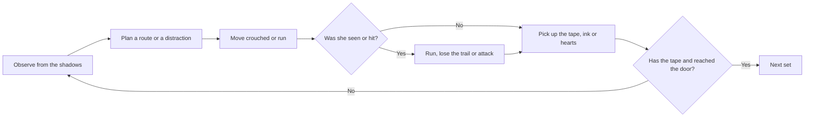

# Gameplay

## Gameplay summary

### Brief

One player controls the protagonist from a high-angle camera. In each of the 5 sets, her goal is to find the set's tape and reach the exit door without being erased. The obstacles are AI cartoons that patrol with sight, hearing and "smell" (they follow the ink trail when she is hurt), security cameras and spotlights. The tactics are hiding in the dark, moving crouched, avoiding noise, creating distractions and, when needed, attacking with the ink pen or the correction fluid.

### Detailed

Each set is a maze of giant-scale props. The AI cartoons follow patrol routes and have three states: patrol, investigate (when they hear a noise, see something odd or find an ink trail) and chase (when they see her). If an enemy hits the protagonist (the player), she loses one of her 3 hearts and bleeds ink: for about 6 seconds she leaves a trail that enemies can follow, even if she hides. With no hearts left, she is erased and it is game over.

**One minute of play:** the player waits crouched behind a box while an enemy walks by. She sees the set's tape on the other side of an area lit by a spotlight. She throws an ink drop at a can far away: the enemy goes to investigate the noise and then looks toward where the shot came from. She uses that moment to cross through the shadows, but steps on pencil shavings; another enemy arrives and hits her with its eraser, trying to erase her. She loses a heart and starts bleeding ink, and the enemy follows her trail. She swaps to the correction fluid with Q, circles some boxes until the trail dries, sneaks up from behind and erases the enemy with one hit. She picks up the tape and a frame from her past appears: her acting as a cowgirl in her old show.

Ink is scarce: it carries over from one set to the next and is refilled with inkwells. Taking out enemies is possible, but sneaking past unseen is usually safer and faster.

## Modes

- **Single player (bootcamp scope):** a 5-set campaign: set 1 is the tutorial, sets 2, 3 and 4 come in random order and set 5 is the finale against The Replacement. This is the mode being built and shown in the pitch.
- **Multiplayer (planned, outside the current scope):** the team will look at how to add it once the core mechanics are ready. The idea is a co-op mode: several forgotten cartoons, each with its own tape and story, escape together. Nobody wants to be forgotten.

## Victory and defeat conditions

- **Winning a set:** pick up the set's tape and reach the exit door. The door only opens with the tape of the current set.
- **Winning the game:** clear the 5 sets and defeat The Replacement in the set of potential ideas to go back on the air.
- **Defeat:** losing all 3 hearts. The protagonist is erased, everything goes dark and the game over screen appears; from there the player goes back to the main menu. Running out of time is also a defeat: each set has a time limit (proposal: 5 minutes) before the door is sealed and everything falls into oblivion.
- **Results:** after winning, a short cutscene plays first: with all her memories recovered, the protagonist is the most complete cartoon in the studio and they put her on the air live. Then the game shows the time, how many times she was detected and the tapes recovered (x/5), with a grade of S, A, B, C, D or E: the fewer detections, the better the grade. This invites players to replay with a different set order.

## Core loop

The loop that repeats in every set:

1. **Observe:** read patrols, cameras, lights and noisy floors from the shadows.
1. **Plan:** choose a route, distract with noise or a shot, or set up an attack from behind.
1. **Move:** advance crouched or run between dark areas, avoiding spotlights and noisy shavings.
1. **React:** if she is seen or hit, run away, lead enemies away from her trail, shoot ink or swap to the correction fluid.
1. **Collect:** take the set's tape, inkwells (ammo) and hearts to recover health.
1. **Advance:** go through the door to the next set.

## Core mechanics

Numbers are starting values and will be tuned during testing.

### Movement and noise

#### Details

The protagonist walks silently with WASD, runs with Shift (fast but noisy) and toggles crouch with Ctrl (slow, quiet and with a smaller detection range). Pencil shavings on the floor make noise when stepped on. Each noise has a radius, and enemies inside it go to investigate where it came from.

#### Implementation

PlayerController with CharacterController and the Input System. Running emits a noise event with an 8 m radius, and shavings, 6 m. Noise detection uses Senses 3 (set up by Sebas, to be confirmed) or, if needed, a custom NoiseSystem that alerts the EnemyAI inside the radius.

### Light and darkness

#### Details

Dark areas hide the protagonist; spotlights expose her and make her visible from farther away. She has no light of her own and does not emit any.

#### Implementation

Light and shadow zones as trigger volumes (LightZone) with an exposure value from 0 to 1 that multiplies the enemy's sight range. (Senses 3 can handle light as a detection modifier.)

### Hearts and ink trail

#### Details

The protagonist has 3 hearts, shown in the HUD. Each enemy hit takes one and makes her bleed ink: for about 6 seconds she leaves a trail of drops on the floor that enemies can follow. Hiding does not remove the trail; to lose them she has to get away while the drops dry, or face them. Hearts spread across the sets give one back. With 0 hearts she is erased and it is game over.

#### Implementation

PlayerHealth (3 hearts) publishes OnHeartsChanged. InkTrail drops a trail point every 0.3 s while she bleeds, and each point disappears after 6 s. Enemies can follow the points with the smell sense of Senses 3 or with a TrailFollower component that goes to the most recent point in view.

### Enemies: AI cartoons

#### Details

Cartoons laser-printed on paper, always smiling (a fake smile). They patrol, investigate noises, follow ink trails and chase the protagonist to hit her with their eraser. They do not use firearms. Since they are made of paper, ink stains and dissolves them. There are at least 3 enemies per set; the final number will be tuned during testing.

#### Implementation

EnemyAI with a NavMeshAgent and a state machine: Patrol, Investigate, Chase and Stunned (stained). Perception with Senses 3 (sight, hearing, smell). They take 2 ink hits.

### Weapons: ink pen and correction fluid

#### Details

The protagonist carries two weapons and swaps between them with Q. With the pen equipped, left click throws an ink drop in an arc toward the mouse: the first hit stains the enemy and slows it down, the second one dissolves it. Ammo is limited, carries over from one set to the next and is refilled with inkwells. Shooting makes noise: the enemy looks at what was hit and then investigates where the shot came from. A drop on a camera blinds it for 2 to 3 seconds.

With the correction fluid equipped, left click is a melee hit. From behind and unseen, it takes out the enemy in one silent hit. If the enemy has already seen her, it takes two hits and the enemy can strike back. There is a cooldown between hits so the attack can't be spammed.

#### Implementation

WeaponSwitcher swaps between InkPen and CorrectorMelee with the Q action of the Input System. InkPen gets the point on the floor with a raycast from the mouse, calculates the arc and launches an InkProjectile with a Rigidbody that deals damage and emits noise on impact. CorrectorMelee checks whether the attack comes from behind (more than 120° from the enemy's front) and whether the enemy is alert. Proposed starting ammo: 5 drops.

### Security cameras

#### Details

They sweep the area with a cone. If they detect the protagonist, an alarm goes off and calls the nearest enemy. They can't be destroyed: ink blinds them for 2 to 3 seconds, although it is usually better to hide while they look the other way and save ink.

#### Implementation

SecurityCamera rotates between two angles and uses Senses 3 sight. When it detects her, it publishes OnAlarm(position) and the GameManager sends the nearest enemy to investigate.

### Tapes, doors and set order

#### Details

Each set has a single tape, the most valuable item in the game. Picking it up shows a frame from the protagonist's past (for example, acting as a cowgirl); if there is time, it will be a short animation of the memory. The HUD counts the tapes (x/5). The tape is required: without it, the set's door won't open. Each set's door leads to the next one: after set 1, the order of sets 2, 3 and 4 is random (6 combinations), and set 5 with The Replacement always comes last.

#### Implementation

MemoryTape (derived from Collectible) reads its image, or its animation if there is one, from a MemoryData ScriptableObject. When a run starts, the GameManager shuffles sets 2 to 4 and stores the order; SetDoor calls LoadNextSet(). The scene manager handles entering and leaving each set and going back to the main menu after a game over.
