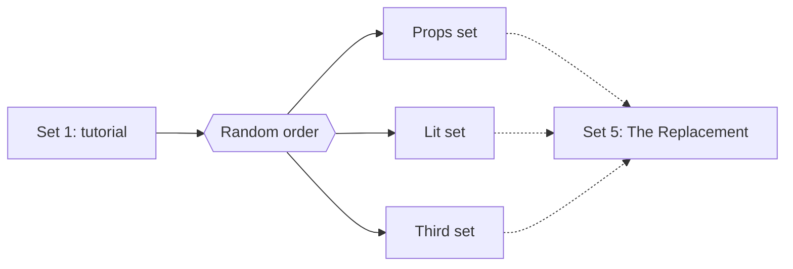

# Level design

Level design is based on a TV and animation studio (the classics room, closed for years) where the game takes place. It works like a maze: the player has to use the walls and objects in each level to hide from the threat of the AI-generated cartoons.

The game has 5 sets (rooms). Set 1 is the tutorial. When the player crosses its door, the game randomly picks the order of sets 2, 3 and 4, which gives 6 possible routes. Set 5 is always the finale, with The Replacement. Each set has a single tape. Since sets 2 to 4 can come in any order, each one must have a similar difficulty and be playable without depending on the others.

## Set 1: the dark set (tutorial)

- Goal: learn and master the stealth mechanics, and try the pen, the correction fluid and the weapon swap.
- The studio's classics room, closed for years, with the lights off.
- Prop boxes, old recording tapes, walls made of boxes, tapes and old cameras.
- The enemies are AI-generated cartoons with more modern, stylized art.

## Props set (random)

- Goal: master hiding behind objects to stay stealthy.
- The studio's classics room, closed for years, with dark areas and dimly lit areas.
- Walls made of boxes and old film props, old cameras, sheets of paper and paper notes to hide behind, and AI-made cartoons as enemies.

## Lit set (random)

- Goal: use every mechanic, including attacks, to move forward stealthily.
- The studio's classics room, closed for years, with brighter areas and some dimly lit areas.
- Walls made of boxes and old film props, old cameras, sheets of paper and paper notes to hide behind, and AI-made cartoons as enemies.

## Third random set (to be defined)

- Proposal: a set with security cameras and pencil shavings on the floor, focused on noise and alarms. Oscar defines its design.

## Set 5: the set of potential ideas

- Goal: defeat The Replacement and go back on the air in a renewed show.
- The studio's final set, with the boss fight. Design to be defined in Sprint 2.
