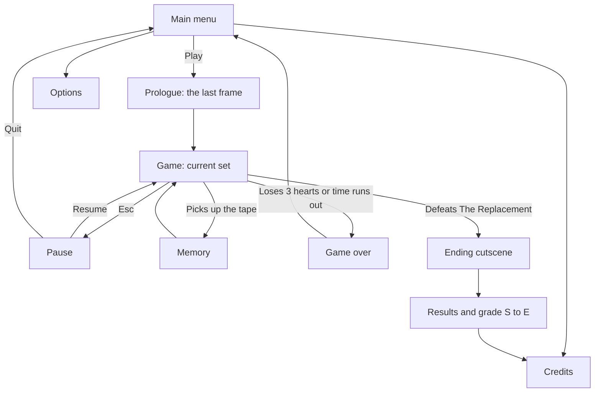

# Technical

## Screens

Screen flow: main menu; game (set 1, then sets 2 to 4 in random order, then set 5); pause with access to options or back to the menu; memory when a tape is picked up; game over when she loses all 3 hearts or runs out of time, back to the main menu; ending cutscene, results with a grade, and credits.

### Title screen

The classics room in the background with the game logo, framed by a ring of light bulbs. Buttons: Play, Options, Credits and Quit, shaped like ink blots (Play in mustard).

### In game

Minimal HUD:

- hearts (up to 3);
- inkwell with the available ink: a jar that empties and fills, with no numbers;
- tapes recovered (x/5);
- stealth eye (how visible she is);
- time left in the set;
- equipped weapon (pen or correction fluid).

#### Inventory

- There is no inventory screen. Whatever she picks up shows directly in the HUD.

#### Combat

- Ollie has up to 3 hearts.
- Each enemy hit takes a heart and makes her bleed ink for about 6 seconds. With 0 hearts she is erased and it is game over: back to the main menu.
- The melee attack (correction fluid) silently takes out an enemy that hasn't seen her; if it has, it takes two hits.
- The ranged attack (pen) uses ink, which is very limited. Ammo doesn't reset: it carries over from one set to the next.

#### Pickups

Three kinds of pickups spread across the rooms:

- **Inkwell:** refills the available ink.
- **Heart:** gives back one heart.
- **Tape:** one per set; shows a memory, adds to the tape counter and opens the set's door.

### Options menu

Music volume, sound effects volume, fullscreen or windowed, and a controls view. Proposal: language (Spanish or English).

### Credits

- Juan Sebastián Gravini Contreras: project manager and programmer.
- Daniel Esteban Ardila Alzate: programmer and UX.
- Oscar Alberto Pinedo Camacho: game artist.
- Laura Muñoz Perez: UI/UX.
- Nerlyn Juliet Carlosama Molina: sound designer and documentation.
- Also: Unity packages, fonts (Caprasimo and DynaPuff, OFL license), sounds and music with their licenses, and the AI use statement.

## Game engine

Unity 6. It is the bootcamp's engine and the one the team knows; it has NavMesh for enemy AI, the Input System for controls, and it exports to WebGL to publish on itch.io. It relies on Asset Store packages: Senses 3 (enemy perception) and Flat Kit (toon shading and cartoon outline).

## Controls

**Move:** WASD

- Moves Ollie in four directions. Walking makes no noise.

**Run:** Shift (hold)

- Increases speed and makes noise that nearby enemies can hear. When released, she walks again.

**Crouch:** Control (hold)

- Lowers speed, noise and the range at which enemies detect her.

**Attack:** Left click

- With the pen: throws an ink drop in an arc toward the mouse. Uses ink.
- With the correction fluid: melee hit. From behind and unseen, it takes out the enemy silently.

**Swap weapon:** Q

- Switches between the ink pen and the correction fluid.

**Interact:** E

- Picks up inkwells, hearts and the tape.

**Pause:** Esc

- Pauses and resumes the game. From the pause menu the player can go back to the main menu.

**Aim:** Mouse (x and y position)

- Aims the ink shot.
