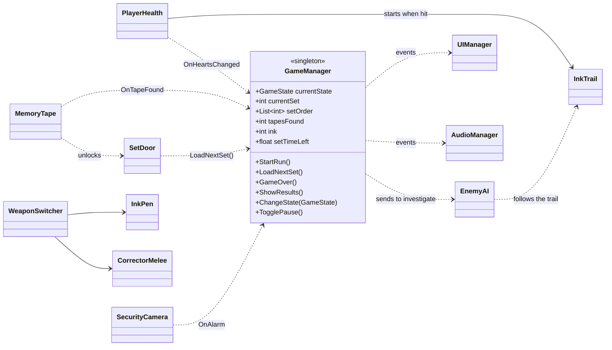

# Development

## Classes

Main classes, from base to derived. Values are starting points that will be tuned during testing; these are options, not all of them are guaranteed to be used, and they may change along the way.

### GameManager (singleton design pattern)

- **States:** MainMenu, Playing, Paused, Memory, GameOver and Victory.
- **Properties:** currentState, currentSet, setOrder (sets 2 to 4 shuffled), tapesFound (0 to 5), ink, setTimeLeft.
- **Methods:** ChangeState(), StartRun(), LoadNextSet(), GameOver(), ShowResults(), TogglePause().
- **Events:** OnStateChanged, OnTapeFound, OnInkChanged, OnHeartsChanged, OnAlarm. The UI and audio listen to these events instead of looking for the GameManager.

### Character (base, implements the IDamageable interface)

- **Base:** health, moveSpeed; TakeDamage(), Die().
- **PlayerController:** hearts 3, walkSpeed 3, runSpeed 6, crouchSpeed 1.5, isBleeding, currentWeapon. Scripts: PlayerMovement, PlayerHealth, InkTrail, WeaponSwitcher, InkPen, CorrectorMelee.
- **EnemyAI:** health 2, patrolSpeed 2, chaseSpeed 4.5. States: Patrol, Investigate, Chase, Stunned. Perception with Senses 3 (sight, hearing, smell for the trail).
- **BossReplacement (The Replacement):** derived from EnemyAI, with more health and its own phases (Sprint 2).

### Collectible (base)

- **Base:** OnCollect().
- **MemoryTape:** the single tape in each set; reads its image, or its animation if there is one, from a MemoryData ScriptableObject.
- **InkPickup:** inkwell; refills ink.
- **HeartPickup:** gives back one heart.

### Projectile (base)

- **InkProjectile:** ballistic arc, damage 1, noiseRadius 5 m; deals damage and emits noise on impact.

### Systems and environment

- **InkTrail:** drops trail points every 0.3 s while the protagonist bleeds; each point lasts 6 s.
- **LightZone:** trigger with exposure (0 in shadow, 1 under a spotlight).
- **SecurityCamera:** sweeps between two angles, blindTime 2.5 s; fires OnAlarm.
- **SetDoor:** each set's exit door; calls GameManager.LoadNextSet().
- **SceneLoader:** entering and leaving each set, and going back to the main menu after a game over.
- **UIManager and AudioManager:** listen to the GameManager's events.

### GameManager class diagram

The GameManager is the only singleton. The other classes notify it through events and it changes the game state.

## Applied principles and patterns

How the code is organized. The singleton is a design pattern, not a principle; both are listed here, along with the object-oriented programming (OOP) basics.

- **Single responsibility (SOLID):** each script does one thing: PlayerMovement moves, PlayerHealth handles the hearts, InkTrail leaves the trail and AudioManager only plays sound.
- **Open/closed (SOLID):** Collectible is the base; MemoryTape, InkPickup and HeartPickup extend it without changing it. A new pickup is a new class.
- **Liskov substitution (SOLID):** BossReplacement derives from EnemyAI and works anywhere an enemy works.
- **Interface segregation (SOLID):** IDamageable only asks for TakeDamage(); it is implemented by the protagonist, the enemies and The Replacement.
- **Dependency inversion (SOLID):** the UI and audio don't look for the GameManager: they listen to its events (OnHeartsChanged, OnTapeFound, OnAlarm).
- **Singleton (pattern):** the GameManager is the only instance and stores the state of the run.
- **Observer (pattern):** C# events connect the GameManager with the UI, audio and doors.
- **State machine (pattern):** EnemyAI switches between Patrol, Investigate, Chase and Stunned.
- **OOP:** inheritance (Character → PlayerController and EnemyAI), polymorphism (a different TakeDamage() in each one) and encapsulation (private fields with [SerializeField] to tune them from the Inspector).

## Project conventions

- Folders under `Assets/_Project/` and personal tests in `Assets/_Sandbox/<name>/`.
- Prefixed names: `SPR_`, `MAT_`, `PF_`, `SFX_`, `MUS_`, `FNT_`, `VFX_`.
- The same scene hierarchy in every scene: `--- Managers ---`, `--- Environment ---`, `--- Gameplay ---`, `--- UI ---`, `--- Lighting ---`, `--- Audio ---`.
- Comments in English; tunable values exposed in the Inspector.
- Issues, PRs and commits in English. Each asset goes in the same commit as its `.meta` file.
- Team board on Trello (private; the link is in the Google Doc). Game repository: [Vacuumgentleman/FinalProject](https://github.com/Vacuumgentleman/FinalProject).
