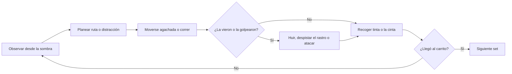

# Jugabilidad

## Resumen de jugabilidad

### Breve

Un jugador controla a la caricatura olvidada desde una cámara cenital (3D top-down). Su meta en cada nivel es encontrar la cinta de ese set, un recuerdo único, y llegar al carrito de salida sin ser borrada. Los obstáculos son caricaturas de IA que patrullan con visión y oído, cámaras de seguridad y reflectores. Las tácticas son esconderse en la oscuridad, moverse agachada, evitar el ruido, distraer y, cuando hace falta, atacar con la pluma de tinta o con el corrector.

### Detallado

El nivel es un laberinto de props a escala gigante. La protagonista llega en un carrito y el jugador ve el set desde arriba. Las caricaturas de IA siguen rutas de patrulla y tienen tres estados: patrulla, investigar (cuando oyen un ruido, ven algo raro o encuentran un rastro de tinta) y persecución (cuando la ven).

Si un enemigo la golpea, la protagonista sangra tinta: durante unos 6 segundos deja un rastro de gotas que los enemigos pueden seguir, y esconderse no lo borra. Si la alcanzan del todo, la borran: pierde una vida y la sala se reinicia.

**Un minuto de juego:** el jugador espera agachado detrás de una caja mientras un enemigo pasa. Ve la cinta del nivel al otro lado de una zona iluminada por un reflector. Lanza una gota de tinta contra una lata lejana: el enemigo va a investigar el ruido y después mira hacia el lugar del disparo. Aprovecha esos segundos para cruzar por la sombra, pero pisa virutas de lápiz; otro enemigo llega y la golpea con su borrador. Ahora sangra tinta y el enemigo sigue su rastro. El jugador lo hace dar una vuelta entre las cajas hasta que el rastro se seca, se acerca por la espalda y lo elimina con el corrector. Recoge la cinta y aparece un cuadro de su pasado: ella actuando como vaquera en su viejo show.

La tinta es escasa: se reinicia al entrar a cada sala y se recarga con tinteros, así que cada disparo cuenta. Eliminar enemigos es posible, pero pasar sin ser visto suele ser más seguro y más rápido.

## Modos

- **Un jugador (alcance del bootcamp):** campaña de tres niveles y jefe final. Es el modo que se construye primero y el que se presenta en el pitch.
- **Multijugador (planeado, fuera del alcance actual):** el equipo revisará cómo incorporarlo cuando las mecánicas base estén listas. La idea original era todos contra todos con sigilo: puntos por no ser descubierto y una sola salida para el ganador.

## Condiciones de victoria y derrota

| | Condición | Qué ve y oye el jugador |
| --- | --- | --- |
| Ganar un nivel | Llegar al carrito de salida. [[¿La cinta del nivel es obligatoria para activar el carrito o es opcional?]] | [[Transición en carrito al siguiente set]] |
| Ganar el juego | Llegar al set de ideas potenciales, vencer a El Reemplazo y subir al cohete hacia un show renovado | [[Escena final: primer cuadro del nuevo show]] |
| Derrota | Un enemigo la alcanza y la borra: pierde una de sus 3 vidas y la sala se reinicia. Sin vidas, se reinicia el nivel (propuesta). No hay límite de tiempo. | [[Animación de borrado y reintento]] |

## Ciclo principal (core loop)

1. **Observar:** leer patrullas, cámaras, luces y ruido del suelo desde la sombra.
2. **Planear:** elegir ruta, distraer con ruido o con un disparo, o preparar un ataque por la espalda.
3. **Moverse:** avanzar agachada o correr entre zonas oscuras, evitando reflectores y virutas.
4. **Reaccionar:** si la ven o la golpean, huir, alejar al enemigo de su rastro, disparar o usar el corrector.
5. **Recolectar:** tomar tinta (munición) y la cinta del nivel (recuerdo).
6. **Avanzar:** llegar al carrito y pasar al siguiente set.

## Mecánicas principales

Los valores numéricos son iniciales y se ajustan en las pruebas.

### Movimiento y ruido

#### Detalles

La protagonista camina con WASD, corre con Shift y se agacha con Ctrl. Caminar no hace ruido; correr es rápido pero ruidoso; agacharse es lento, silencioso y reduce el rango en que la detectan. Las virutas de lápiz del suelo hacen ruido al pisarlas. Cada ruido tiene un radio y los enemigos que estén dentro van a investigar el punto de origen.

#### Implementación

PlayerController con CharacterController y el Input System. Correr emite un NoiseEvent (posición, radio de 8 m); las virutas son triggers que emiten un ruido de 6 m. Un NoiseSystem avisa a los EnemyAI dentro del radio. Si el equipo usa Senses 3, sus componentes de ruido reemplazan este sistema.

### Luz y oscuridad

#### Detalles

Las zonas oscuras esconden a la protagonista; los reflectores la exponen y la hacen visible desde más lejos. Ella no tiene luz propia.

#### Implementación

Las zonas de luz y sombra son volúmenes trigger (LightZone) con un valor de exposición. La visibilidad va de 0 a 1 y multiplica el alcance del cono de visión del enemigo.

### Rastro de tinta

#### Detalles

Cuando un enemigo golpea a la protagonista, ella sangra tinta y deja un rastro de gotas en el suelo durante unos 6 segundos. Los enemigos pueden seguir ese rastro hasta ella. Esconderse no lo borra: la única forma de perderlos es moverse lejos mientras las gotas se secan, o enfrentarlos.

#### Implementación

InkTrail deja un punto de rastro cada 0,3 s mientras está activo, con su hora de creación; cada punto se borra a los 6 s. Un enemigo que encuentra un punto pasa a Investigate y va al punto más reciente que tenga a la vista, como migas de pan. [[Número de enemigos por sala: el equipo aún no lo define; puede ser 1.]]

### Enemigos: caricaturas de IA

#### Detalles

Caricaturas impresas en papel, siempre sonrientes. Patrullan, investigan ruidos, siguen rastros de tinta y persiguen a la protagonista para borrarla con su borrador. No usan armas de fuego. Como son de papel, la tinta los mancha y los disuelve.

#### Implementación

EnemyAI con NavMeshAgent y una máquina de estados: Patrol, Investigate, Chase y Stunned (manchado). Visión con cono y raycast contra obstáculos; oído por NoiseEvent; rastro por InkTrail. Aguantan 2 impactos de tinta. Senses 3 puede reemplazar la detección (su sentido del olfato sirve para el rastro) si el equipo decide usarlo.

### Pluma de tinta (ataque a distancia)

#### Detalles

La pluma es del tamaño de la protagonista. Con clic derecho lanza una gota de tinta en arco hacia donde apunta el mouse. El primer impacto mancha al enemigo y lo frena; el segundo lo disuelve. La munición es limitada: se reinicia en cada sala y se recarga con tinteros. El disparo hace ruido: el enemigo mira qué fue golpeado y luego investiga de dónde vino. Una gota en una cámara la ciega de 2 a 3 segundos.

#### Implementación

InkPen toma el punto del suelo con un raycast desde el mouse, calcula la velocidad inicial del arco y lanza un InkProjectile con Rigidbody. Al impactar, aplica daño a cualquier IDamageable y emite un NoiseEvent. Munición inicial propuesta: 5 gotas.

### Corrector líquido (cuerpo a cuerpo)

#### Detalles

Con clic izquierdo, por la espalda y sin ser vista, el corrector elimina al enemigo de un golpe y en silencio. Si el enemigo ya la vio, el ataque funciona pero necesita dos golpes, y el enemigo puede intentar borrarla mientras tanto. Hay un tiempo de espera entre golpes para evitar que se abuse del ataque.

#### Implementación

MeleeAttack revisa el estado del enemigo y el ángulo entre su frente y la protagonista (más de 120° cuenta como por la espalda). Golpe sigiloso: eliminación inmediata sin NoiseEvent. Golpe con el enemigo alerta: 1 de daño y 1 s de espera entre golpes.

### Cámaras de seguridad

#### Detalles

Barren el área con un cono. Si detectan a la protagonista, suena una alarma que llama al enemigo más cercano. No se destruyen: la tinta las ciega de 2 a 3 segundos, aunque casi siempre conviene esconderse mientras miran a otro lado.

#### Implementación

SecurityCamera rota entre dos ángulos y usa el mismo cono de visión que los enemigos. Al detectar, publica OnAlarm(posición) y el GameManager envía al enemigo más cercano a investigar.

### La cinta: un recuerdo por nivel

#### Detalles

Cada nivel tiene una sola cinta, un objeto único y valioso. Al recogerla se muestra un cuadro del pasado de la protagonista, por ejemplo actuando como vaquera en su show. Si queda tiempo, el cuadro se reemplaza por una animación corta del recuerdo que se ve en ese mismo momento.

#### Implementación

MemoryTape (deriva de Collectible) lee su imagen, o su clip de animación si existe, de un ScriptableObject MemoryData. Al recogerla, el GameManager marca la cinta del nivel como encontrada y la UI muestra el recuerdo.

### Tinteros, carritos y jefe final

#### Detalles

Los tinteros recargan la pluma. Al final de cada set, un carrito lleva al siguiente nivel y sirve como punto de guardado. En el set de ideas potenciales espera El Reemplazo.

#### Implementación

InkPickup deriva de Collectible. LevelExit (el carrito) llama a GameManager.CompleteLevel() y carga la escena siguiente. El jefe reutiliza EnemyAI con fases propias, a diseñar en el Sprint 2.
