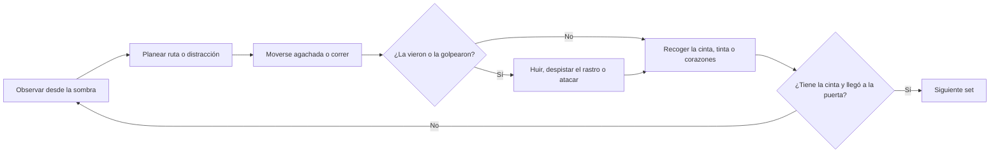

# Jugabilidad

## Resumen de jugabilidad

### Breve

Un jugador controla a Ollie desde una cámara en picado. En cada uno de los 5 sets, su meta es encontrar la cinta del set y llegar a la puerta de salida sin ser borrada. Los obstáculos son caricaturas de IA que patrullan con visión, oído y "olfato" (siguen el rastro de tinta cuando ella está herida), cámaras de seguridad y reflectores. Las tácticas son esconderse en la oscuridad, moverse agachada, evitar el ruido, distraer y, cuando hace falta, atacar con la pluma de tinta o con el corrector.

### Detallado

Cada set es un laberinto de props a escala gigante. Las caricaturas de IA siguen rutas de patrulla y tienen tres estados: patrulla, investigar (cuando oyen un ruido, ven algo raro o encuentran un rastro de tinta) y persecución (cuando la ven). Si un enemigo golpea a Ollie, ella pierde un corazón de 3 y sangra tinta: durante unos 6 segundos deja un rastro que los enemigos pueden seguir, aunque se esconda. Sin corazones, la borran y es game over.

**Un minuto de juego:** la jugadora espera agachada detrás de una caja mientras un enemigo pasa. Ve la cinta del set al otro lado de una zona iluminada por un reflector. Lanza una gota de tinta contra una lata lejana: el enemigo va a investigar el ruido y después mira hacia el lugar del disparo. Aprovecha para cruzar por la sombra, pero pisa virutas de lápiz; otro enemigo llega y la golpea con su borrador con intención de borrarla. Pierde un corazón y empieza a sangrar tinta, y el enemigo sigue su rastro. Cambia al corrector con Q, rodea unas cajas hasta que el rastro se seca, se acerca por la espalda y lo borra de un golpe. Recoge la cinta y aparece un cuadro de su pasado: ella actuando como vaquera en su viejo show.

La tinta es escasa: se conserva de un set a otro y se recarga con tinteros. Eliminar enemigos es posible, pero pasar sin ser vista suele ser más seguro y más rápido.

## Modos

- **Un jugador (alcance del bootcamp):** campaña de 5 sets: el set 1 es tutorial, los sets 2, 3 y 4 salen en orden aleatorio y el set 5 es el final contra El Reemplazo. Es el modo que se construye y se presenta en el pitch.
- **Multijugador (planeado, fuera del alcance actual):** el equipo revisará cómo incorporarlo cuando las mecánicas base estén listas. La idea es un modo cooperativo: varias caricaturas olvidadas, cada una con su propia cinta e historia, escapan juntas. Nadie quiere ser olvidado.

## Condiciones de victoria y derrota

- **Ganar un set:** recoger la cinta del set y llegar a la puerta de salida. La puerta solo se abre con la cinta del set actual.
- **Ganar el juego:** superar los 5 sets y vencer a El Reemplazo en el set de ideas potenciales para volver al aire.
- **Derrota:** perder los 3 corazones. Ollie es borrada, todo se vuelve oscuridad y aparece la pantalla de game over; de ahí se vuelve al menú principal. También es derrota si se acaba el tiempo: cada set tiene un límite (propuesta: 5 minutos) antes de que la puerta quede sellada y todo caiga en el olvido.
- **Resultados:** al vencer, primero se ve una cinemática corta: con todas sus memorias recuperadas, Ollie es la caricatura más completa del estudio y la sacan al aire en vivo. Después se muestran el tiempo, las veces que la detectaron y las cintas recuperadas (x/5), con una calificación de S, A, B, C, D o E: entre menos veces la detecten, mejor nota. Esto invita a rejugar con otro orden de sets.

## Ciclo principal (core loop)

El ciclo que se repite en cada set:

1. **Observar:** leer patrullas, cámaras, luces y ruido del suelo desde la sombra.
1. **Planear:** elegir ruta, distraer con ruido o con un disparo, o preparar un ataque por la espalda.
1. **Moverse:** avanzar agachada o correr entre zonas oscuras, evitando reflectores y virutas que hacen ruido.
1. **Reaccionar:** si la ven o la golpean, huir, alejar a los enemigos de su rastro, disparar tinta o cambiar al corrector.
1. **Recolectar:** tomar la cinta del set, tinteros (munición) y corazones para recuperar vida.
1. **Avanzar:** cruzar la puerta hacia el siguiente set.

## Mecánicas principales

Los valores numéricos son iniciales y se ajustan en las pruebas.

### Movimiento y ruido

#### Detalles

Ollie camina con WASD sin hacer ruido, corre con Shift (rápido pero ruidoso) y se agacha con Ctrl toggle (lento, silencioso y con menos rango de detección). Las virutas de lápiz del suelo hacen ruido al pisarlas. Cada ruido tiene un radio y los enemigos que estén dentro van a investigar el punto de origen.

#### Implementación

PlayerController con CharacterController y el Input System. Correr emite un evento de ruido de 8 m de radio y las virutas, de 6 m. La detección de ruido usa Senses 3 (configuración a cargo de Sebas, por confirmar) o, si hace falta, un NoiseSystem propio que avisa a los EnemyAI dentro del radio.

### Luz y oscuridad

#### Detalles

Las zonas oscuras esconden a Ollie; los reflectores la exponen y la hacen visible desde más lejos. Ella no tiene luz propia ni la emite.

#### Implementación

Zonas de luz y sombra como volúmenes trigger (LightZone) con un valor de exposición de 0 a 1, que multiplica el alcance de la visión del enemigo. (Senses 3 puede manejar la luz como modificador de detección).

### Corazones y rastro de tinta

#### Detalles

Ollie tiene 3 corazones, visibles en el HUD. Cada golpe de un enemigo le quita uno y la hace sangrar tinta: durante unos 6 segundos deja un rastro de gotas en el suelo que los enemigos pueden seguir. Esconderse no borra el rastro; para perderlos hay que alejarse mientras las gotas se secan o enfrentarlos. Hay corazones repartidos por los sets que devuelven uno. Con 0 corazones, la borran y es game over.

#### Implementación

PlayerHealth (3 corazones) publica OnHeartsChanged. InkTrail deja un punto de rastro cada 0,3 s mientras sangra, y cada punto se borra a los 6 s. Los enemigos pueden seguir los puntos con el olfato de Senses 3 o con un componente TrailFollower que va al punto más reciente que tengan a la vista.

### Enemigos: caricaturas de IA

#### Detalles

Caricaturas impresas a laser en papel, siempre sonrientes (sonrisa falsa). Patrullan, investigan ruidos, siguen rastros de tinta y persiguen a Ollie para golpearla con su borrador. No usan armas de fuego. Como son de papel, la tinta los mancha y los disuelve. Hay mínimo 3 enemigos por set; el número final se ajusta en las pruebas.

#### Implementación

EnemyAI con NavMeshAgent y una máquina de estados: Patrol, Investigate, Chase y Stunned (manchado). Percepción con Senses 3 (visión, oído, olfato). Aguantan 2 impactos de tinta.

### Armas: pluma de tinta y corrector

#### Detalles

Ollie lleva dos armas y cambia entre ellas con Q. Con la pluma equipada, clic izquierdo lanza una gota de tinta en arco hacia donde apunta el mouse: el primer impacto mancha al enemigo y lo frena, el segundo lo disuelve. La munición es limitada, se conserva de un set a otro y se recarga con tinteros. El disparo hace ruido: el enemigo mira qué fue golpeado y luego investiga de dónde vino. Una gota en una cámara la ciega de 2 a 3 segundos.

Con el corrector equipado, clic izquierdo da un golpe cuerpo a cuerpo. Por la espalda y sin ser vista, elimina al enemigo de un golpe y en silencio. Si el enemigo ya la vio, necesita dos golpes y el enemigo puede responder. Hay un tiempo de espera entre golpes para que no se abuse del ataque.

#### Implementación

WeaponSwitcher alterna entre InkPen y CorrectorMelee con la acción Q del Input System. InkPen toma el punto del suelo con un raycast desde el mouse, calcula el arco y lanza un InkProjectile con Rigidbody que, al impactar, aplica daño y emite ruido. CorrectorMelee revisa si el ataque viene por la espalda (más de 120° desde el frente del enemigo) y si el enemigo está alerta. Munición inicial propuesta: 5 gotas.

### Cámaras de seguridad

#### Detalles

Barren el área con un cono. Si detectan a Ollie, suena una alarma que llama al enemigo más cercano. No se destruyen: la tinta las ciega de 2 a 3 segundos, aunque casi siempre conviene esconderse mientras miran a otro lado para no gastar tinta.

#### Implementación

SecurityCamera rota entre dos ángulos y usa visión de Senses 3. Al detectar, publica OnAlarm(posición) y el GameManager envía al enemigo más cercano a investigar.

### Cintas, puertas y orden de los sets

#### Detalles

Cada set tiene una sola cinta, el objeto más valioso del juego. Al recogerla se muestra un cuadro del pasado de Ollie (por ejemplo, actuando como vaquera); si queda tiempo, será una animación corta del recuerdo que se ve en ese momento. El HUD lleva la cuenta de cintas (x/5). La cinta es obligatoria: sin ella, la puerta del set no se abre. La puerta de cada set lleva al siguiente: después del set 1, el orden de los sets 2, 3 y 4 es aleatorio (6 combinaciones), y al final siempre está el set 5 con El Reemplazo.

#### Implementación

MemoryTape (deriva de Collectible) lee su imagen, o su animación si existe, de un ScriptableObject MemoryData. Al iniciar la partida, el GameManager baraja los sets 2 a 4 y guarda el orden; SetDoor llama a LoadNextSet(). El gestor de escenas maneja la entrada y salida de cada set y el regreso al menú principal tras el game over.
