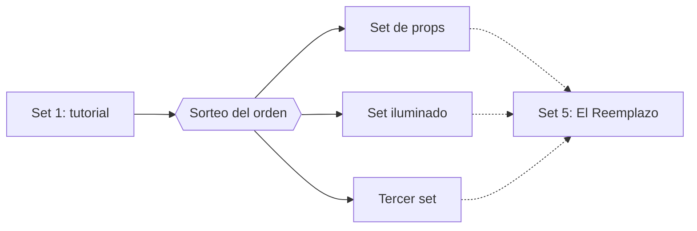

# Diseño de niveles

El diseño de niveles está basado en un estudio de televisión y animación (la sala de los clásicos, cerrada hace años) en el cual se desarrollan los eventos del videojuego, a modo de laberinto, el jugador tendrá que hacer uso de las paredes y objetos en el nivel para poder ocultarse de la amenaza de las caricaturas generadas por IA.

El juego tiene 5 sets (salas). El set 1 es el tutorial. Al cruzar su puerta, el juego elige al azar el orden de los sets 2, 3 y 4, lo que da 6 recorridos posibles. El set 5 es siempre el final, con El Reemplazo. Cada set tiene una sola cinta. Como los sets 2 a 4 pueden salir en cualquier orden, cada uno debe tener una dificultad parecida y poder jugarse sin depender de los otros.

## Set 1: el set apagado (tutorial)

- Objetivo: conocer y dominar la mecánica de sigilo, y probar la pluma, el corrector y el cambio de arma.
- Sala de los clásicos del estudio, cerrada hace años, con luces apagadas.
- Cajas de props, cintas antiguas de grabación, paredes con cajas, cintas y cámaras antiguas.
- Los enemigos son caricaturas generadas por IA con arte más moderno y estilizado.

## Set de props (aleatorio)

- Objetivo: dominar la mecánica de esconderse tras los objetos para aumentar el sigilo.
- Sala de los clásicos del estudio, cerrada hace años, con zonas oscuras y zonas levemente iluminadas.
- Paredes hechas de cajas y props de cine antiguos, cámaras antiguas, hojas de papel y notitas de papel para esconderse, enemigos como caricaturas hechas por la IA.

## Set iluminado (aleatorio)

- Objetivo: usar todas las mecánicas, incluido el ataque, para avanzar con sigilo.
- Sala de los clásicos del estudio, cerrada hace años, con zonas más iluminadas y algunas zonas levemente iluminadas.
- Paredes hechas de cajas y props de cine antiguos, cámaras antiguas, hojas de papel y notitas de papel para esconderse, enemigos como caricaturas hechas por la IA.

## Tercer set aleatorio (por definir)

- Propuesta: un set de cámaras de seguridad y suelo con virutas de lápiz, centrado en el ruido y en la alarma. Oscar define su diseño.

## Set 5: el set de ideas potenciales

- Objetivo: vencer a El Reemplazo y volver al aire en un show renovado.
- Set final del estudio, con la pelea contra el jefe. Diseño por definir en el Sprint 2.
