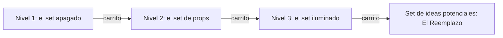

# Diseño de niveles

El diseño de niveles está basado en un estudio de televisión y animación abandonado en el cual se desarrollan los eventos del videojuego. A modo de laberinto, el jugador tendrá que hacer uso de las paredes y objetos del nivel para ocultarse de la amenaza de las caricaturas generadas por IA.



## Nivel 1

| Aspecto | Descripción |
| --- | --- |
| Objetivo | Conocer y dominar la mecánica de sigilo. |
| Ambiente | Estudio de televisión y animación abandonado con luces apagadas. |
| Elemento distintivo | Cajas de props, cintas antiguas de grabación, paredes con cajas, cintas y cámaras antiguas. |
| Mecánicas que enseña | Sigilo: moverse en la sombra, agacharse. |
| Objetos, enemigos, NPC | Los enemigos son caricaturas generadas por IA con arte más moderno y estilizado. Una cinta de recuerdo. |

```antes-despues
assets/img/progresion/nivel-1-greybox.png | assets/img/progresion/nivel-1-arte.png | [[Nivel 1: del greybox al pase de arte]]
```

## Nivel 2

| Aspecto | Descripción |
| --- | --- |
| Objetivo | Dominar la mecánica de esconderse tras los objetos para aumentar el sigilo. |
| Ambiente | Estudio de televisión y animación abandonado, con zonas oscuras y zonas levemente iluminadas. |
| Elemento distintivo | Paredes hechas de cajas y props de cine antiguos, cámaras antiguas, hojas de papel y notitas de papel para esconderse. |
| Mecánicas que enseña | Escondites y cámaras. |
| Objetos, enemigos, NPC | Enemigos como caricaturas hechas por la IA. Una cinta de recuerdo. |

## Nivel 3

| Aspecto | Descripción |
| --- | --- |
| Objetivo | Dominar todas las mecánicas, incluido el ataque, para avanzar con sigilo hasta el cohete de despegue hacia un show renovado. |
| Ambiente | Estudio de televisión y animación abandonado, con zonas más iluminadas y algunas zonas levemente iluminadas. |
| Elemento distintivo | Paredes hechas de cajas y props de cine antiguos, cámaras antiguas, hojas de papel y notitas de papel para esconderse. |
| Mecánicas que enseña | Ataque a distancia y cuerpo a cuerpo. |
| Objetos, enemigos, NPC | Enemigos como caricaturas hechas por la IA y jefe final. Una cinta de recuerdo. |

> [!alerta] El Google Doc dice "jefe final manager del estudio"; el jefe acordado es El Reemplazo. Falta alinearlo.
