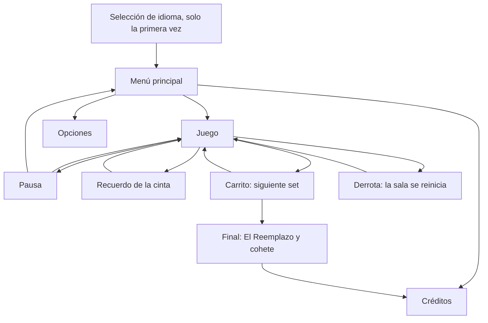

# Aspectos técnicos

## Flujo de pantallas

## Pantallas

### Pantalla de título

Fondo del estudio abandonado con el logo del juego. Botones: Jugar, Opciones, Créditos y Salir.

### En juego

HUD mínimo:

- vidas restantes (máximo 3);
- munición disponible;
- puntaje.

**Inventario.** No hay pantalla de inventario. Lo recogido se refleja directamente en el HUD.

**Combate.**

- El jugador tiene 3 vidas como máximo.
- Si un enemigo lo toca, lo mata. Pierde una vida y la sala se reinicia.
- El ataque cuerpo a cuerpo sirve para eliminar en silencio a un enemigo que no lo ha visto.
- El ataque a distancia consume munición, que es muy limitada. La munición se reinicia al entrar a cada sala y no se traspasa.

**Pickups.** Dos tipos de objeto recogible repartidos por las salas:

- Munición: recarga la munición disponible.
- Puntaje: suma al puntaje del jugador.

> [!alerta] Por alinear con Jugabilidad: aquí el recolectable es "puntaje", y allá es la cinta (un recuerdo único por nivel). Tampoco está definido si un golpe borra de una vez o primero deja el rastro de tinta.

### Menú de opciones

Volumen de música, volumen de efectos y pantalla completa o ventana. [[Idioma: español o inglés]]

### Créditos

| Rol | Integrante |
| --- | --- |
| Project Manager | Juan Sebastián Gravini Contreras |
| Game Artist | Oscar Alberto Pinedo Camacho |
| [[Rol]] | Laura |
| [[Rol]] | Nerlyn Juliet Carlosama Molina |
| [[Rol]] | Daniel Esteban Ardila Alzate |

## Motor

Unity 6. [[Pipeline (URP) y por qué Unity para este juego.]]

## Plataformas y build

| Plataforma | Resolución | Notas |
| --- | --- | --- |
| [[WebGL en itch.io]] | [[960 × 540 en página, 16:9]] | [[Notas]] |
| [[PC Windows]] | [[1920 × 1080]] | [[Requisitos mínimos]] |

## Controles

| Acción | Tecla | Qué hace |
| --- | --- | --- |
| Movimiento | WASD | Mueve al jugador en las cuatro direcciones. Caminar no produce ruido; es la velocidad base para pasar cerca de enemigos sin ser detectado. |
| Correr | Shift (mantener) | Aumenta la velocidad mientras se mantiene. Produce ruido que los enemigos cercanos pueden oír. Al soltar, vuelve a caminar. |
| Agacharse | Control (mantener) | Reduce la velocidad, el ruido y el rango en que los enemigos lo detectan. |
| Ataque cuerpo a cuerpo | Clic izquierdo | Elimina a un enemigo cercano en silencio. Solo es efectivo si el enemigo no lo ha visto. Sin combos. |
| Ataque a distancia | Clic derecho | Dispara hacia donde apunta el mouse. Consume munición, que se reinicia al entrar a cada sala. |
| Interactuar | E | Recoge los objetos de munición y de puntaje. |
| Pausa | P | Pausa y reanuda la partida. Desde la pausa se puede volver al menú principal. |
| Apuntar | Mouse | Apunta el ataque a distancia. |

## Idiomas

[[Español e inglés con el paquete Unity Localization (String Tables). El idioma se elige al entrar por primera vez y se puede cambiar en Opciones.]]
