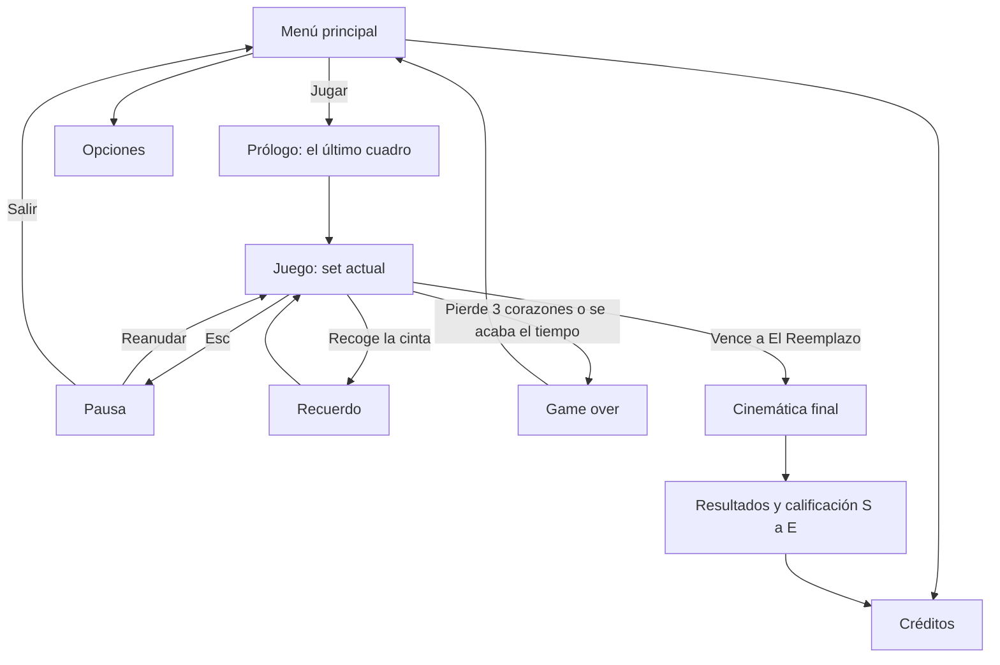

# Aspectos técnicos

## Pantallas

Flujo de pantallas: menú principal; juego (set 1, luego los sets 2 a 4 en orden aleatorio y el set 5); pausa con acceso a opciones o regreso al menú; recuerdo al recoger una cinta; game over al perder los 3 corazones o al acabarse el tiempo, con regreso al menú principal; cinemática final, resultados con calificación y créditos.

### Pantalla de título

Fondo de la sala de los clásicos con el logo del juego, enmarcado por un aro de bombillos. Botones: Jugar, Opciones, Créditos y Salir, como manchas de tinta (Jugar en mostaza).

### En juego

HUD mínimo:

- corazones (máximo 3);
- tintero con la tinta disponible: un frasco que se vacía y se llena, sin números;
- cintas recuperadas (x/5);
- ojo de sigilo (qué tan visible está);
- tiempo restante del set;
- arma equipada (pluma o corrector).

#### Inventario

- No hay pantalla de inventario. Lo recogido se refleja directamente en el HUD.

#### Combate

- La protagonista tiene 3 corazones como máximo.
- Cada golpe de un enemigo le quita un corazón y la hace sangrar tinta durante unos 6 segundos. Con 0 corazones es borrada y es game over: se vuelve al menú principal.
- El ataque cuerpo a cuerpo (corrector) elimina en silencio a un enemigo que no la ha visto; si ya la vio, necesita dos golpes.
- El ataque a distancia (pluma) consume tinta, que es muy limitada. La munición no se reinicia: se conserva de un set a otro.

#### Recogibles

Tres tipos de objeto recogible repartidos por las salas:

- **Tintero:** recarga la tinta disponible.
- **Corazón:** devuelve un corazón.
- **Cinta:** una por set; muestra un recuerdo, suma al contador de cintas y abre la puerta del set.

### Menú de opciones

Volumen de música, volumen de efectos, pantalla completa o ventana, y vista de controles. Propuesta: idioma (español o inglés).

### Créditos

- Juan Sebastián Gravini Contreras: project manager y programador.
- Daniel Esteban Ardila Alzate: programador y UX.
- Oscar Alberto Pinedo Camacho: game artist.
- Laura Muñoz Perez: UI/UX.
- Nerlyn Juliet Carlosama Molina: sound designer y documentación.
- Además: paquetes de Unity, fuentes (Caprasimo y DynaPuff, licencia OFL), sonidos y música con su licencia, y la declaración del uso de IA.

## Motor

Unity 6. Es el motor del bootcamp y el que el equipo conoce; tiene NavMesh para la IA de los enemigos, el Input System para los controles y exporta a WebGL para publicar en itch.io. Se apoya en paquetes de la Asset Store: Senses 3 (percepción de enemigos), Flat Kit (sombreado toon y contorno tipo caricatura).

## Controles

**Movimiento:** WASD

- Mueve a la protagonista en las cuatro direcciones. Caminar no produce ruido.

**Correr:** Shift (mantener)

- Aumenta la velocidad y produce ruido que los enemigos cercanos pueden oír. Al soltarla, vuelve a caminar.

**Agacharse:** Control (mantener)

- Reduce la velocidad, el ruido y el rango en que los enemigos la detectan.

**Atacar:** Clic izquierdo

- Con la pluma: lanza una gota de tinta en arco hacia donde apunta el mouse. Consume tinta.
- Con el corrector: golpe cuerpo a cuerpo. Por la espalda y sin ser vista, elimina en silencio.

**Cambiar arma:** Q

- Alterna entre la pluma de tinta y el corrector.

**Interactuar:** E

- Recoge tinteros, corazones y la cinta.

**Pausa: Esc**

- Pausa y reanuda la partida. Desde la pausa se puede volver al menú principal.

**Apuntar:** Mouse (posición x y)

- Apunta el disparo de tinta.
