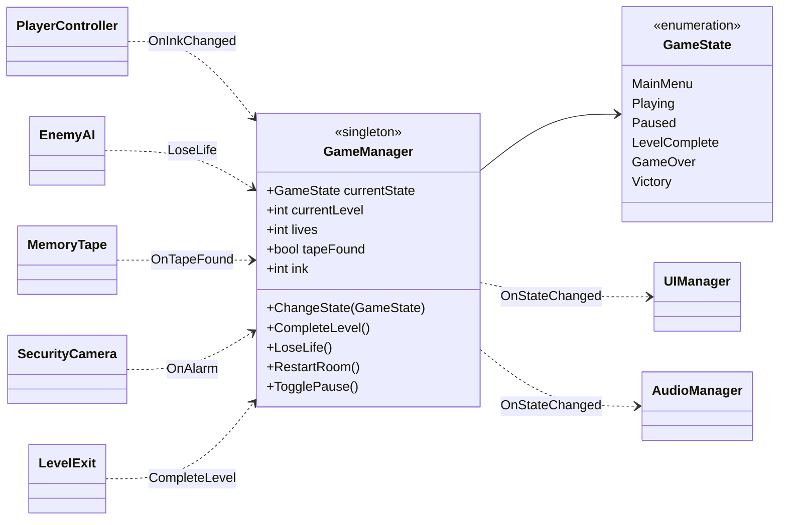

# Desarrollo

## Diagrama de clases

El GameManager es el único singleton. Las demás clases le avisan por eventos y él cambia el estado del juego.

## Clases

Clases principales, de las bases a las derivadas. Los valores son iniciales y se ajustan en las pruebas.

### GameManager (singleton)

- **Estados:** MainMenu, Playing, Paused, LevelComplete, GameOver y Victory.
- **Propiedades:** currentState, currentLevel, lives (3), tapeFound, ink.
- **Métodos:** ChangeState(), CompleteLevel(), LoseLife(), RestartRoom(), TogglePause().
- **Eventos:** OnStateChanged, OnTapeFound, OnInkChanged, OnAlarm. La UI y el audio escuchan estos eventos en lugar de buscar al GameManager.

### Character (base, implementa IDamageable)

- **Base:** health, moveSpeed; TakeDamage(), Die().
- **PlayerController:** walkSpeed 3, runSpeed 6, crouchSpeed 1.5, visibility (0 a 1), isBleeding. Scripts: PlayerMovement, PlayerStealth, InkTrail, InkPen, MeleeAttack.
- **EnemyAI:** health 2, patrolSpeed 2, chaseSpeed 4.5, visionRange 8 m, visionAngle 90°. Estados: Patrol, Investigate, Chase, Stunned. Scripts: EnemySenses, EnemyStateMachine, TrailFollower.
- **BossReplacement (El Reemplazo):** deriva de EnemyAI, con más vida y fases propias (Sprint 2).

### Collectible (base)

- **Base:** OnCollect().
- **MemoryTape:** la cinta única del nivel; lee su imagen, o su animación si existe, de un ScriptableObject MemoryData.
- **InkPickup:** tintero; recarga la tinta hasta el máximo.

### Projectile (base)

- **InkProjectile:** arco balístico, damage 1, noiseRadius 5 m; al impactar aplica daño y emite ruido.

### Sistemas y ambiente

- **NoiseSystem:** recibe NoiseEvent(posición, radio) y avisa a los enemigos cercanos.
- **InkTrail:** deja puntos de rastro cada 0,3 s que duran 6 s; los enemigos los siguen.
- **LightZone:** trigger con exposure (0 en sombra, 1 bajo reflector).
- **SecurityCamera:** barrido entre dos ángulos, blindTime 2.5 s; dispara OnAlarm.
- **LevelExit:** el carrito de salida.
- **UIManager y AudioManager:** escuchan los eventos del GameManager.

## Principios aplicados

| Principio | Dónde se aplica |
| --- | --- |
| Responsabilidad única (SOLID) | [[Ej. AudioManager solo reproduce audio]] |
| [[Abierto/cerrado, inversión de dependencias…]] | [[Dónde]] |

## Convenciones del proyecto

- Carpetas bajo `Assets/_Project/` y pruebas personales en `Assets/_Sandbox/<nombre>/`.
- Nombres con prefijo: `SPR_`, `MAT_`, `PF_`, `SFX_`, `MUS_`, `FNT_`, `VFX_`.
- Jerarquía de escena igual en todas: `--- Managers ---`, `--- Environment ---`, `--- Gameplay ---`, `--- UI ---`, `--- Lighting ---`, `--- Audio ---`.
- Comentarios en inglés; valores ajustables expuestos en el Inspector.
- Issues, PRs y commits en inglés. Cada asset va en el mismo commit que su archivo `.meta`.
- Repositorio: [[enlace al repo de GitHub]] · Tablero: [[enlace a Trello]]
