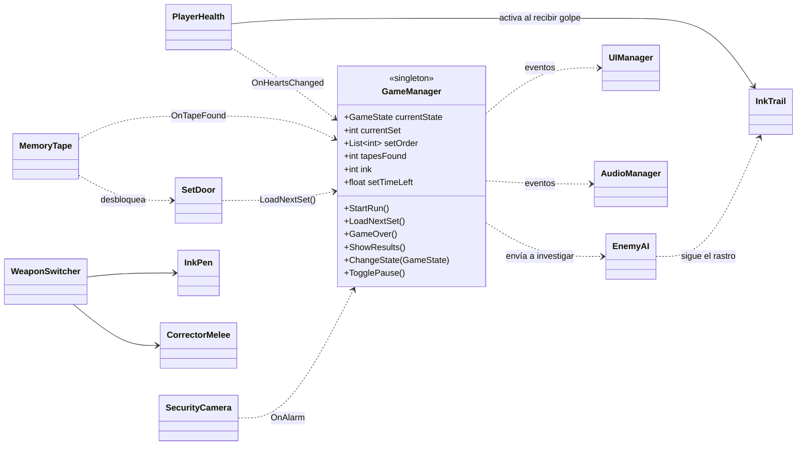

# Desarrollo

## Clases

Clases principales, de las bases a las derivadas. Los valores son iniciales y se ajustan en las pruebas y son posibilidades no garantizamos que se usen todos, está dispuesto a cambios en el proceso.

### GameManager (patrón de diseño singleton)

- **Estados:** MainMenu, Playing, Paused, Memory, GameOver y Victory.
- **Propiedades:** currentState, currentSet, setOrder (sets 2 a 4 barajados), tapesFound (0 a 5), ink, setTimeLeft.
- **Métodos:** ChangeState(), StartRun(), LoadNextSet(), GameOver(), ShowResults(), TogglePause().
- **Eventos:** OnStateChanged, OnTapeFound, OnInkChanged, OnHeartsChanged, OnAlarm. La UI y el audio escuchan estos eventos en lugar de buscar al GameManager.

### Character (base, implementa interfaz IDamageable)

- **Base:** health, moveSpeed; TakeDamage(), Die().
- **PlayerController:** hearts 3, walkSpeed 3, runSpeed 6, crouchSpeed 1.5, isBleeding, currentWeapon. Scripts: PlayerMovement, PlayerHealth, InkTrail, WeaponSwitcher, InkPen, CorrectorMelee.
- **EnemyAI:** health 2, patrolSpeed 2, chaseSpeed 4.5. Estados: Patrol, Investigate, Chase, Stunned. Percepción con Senses 3 (visión, oído, olfato para el rastro).
- **BossReplacement (El Reemplazo):** deriva de EnemyAI, con más vida y fases propias (Sprint 2).

### Collectible (base)

- **Base:** OnCollect().
- **MemoryTape:** la cinta única de cada set; lee su imagen, o su animación si existe, de un ScriptableObject MemoryData.
- **InkPickup:** tintero; recarga la tinta.
- **HeartPickup:** devuelve un corazón.

### Projectile (base)

- **InkProjectile:** arco balístico, damage 1, noiseRadius 5 m; al impactar aplica daño y emite ruido.

### Sistemas y ambiente

- **InkTrail:** deja puntos de rastro cada 0,3 s mientras Ollie sangra; cada punto dura 6 s.
- **LightZone:** trigger con exposure (0 en sombra, 1 bajo reflector).
- **SecurityCamera:** barrido entre dos ángulos, blindTime 2.5 s; dispara OnAlarm.
- **SetDoor:** la puerta de salida de cada set; llama a GameManager.LoadNextSet().
- **SceneLoader:** entrada y salida de cada set y regreso al menú principal tras el game over.
- **UIManager y AudioManager:** escuchan los eventos del GameManager.

### Diagrama de clases del GameManager

El GameManager es el único singleton. Las demás clases le avisan por eventos y él cambia el estado del juego.

## Principios y patrones aplicados

Cómo se organiza el código. El singleton es un patrón de diseño, no un principio; aquí van los dos, junto con la base de programación orientada a objetos (POO).

- **Responsabilidad única (SOLID):** cada script hace una sola cosa: PlayerMovement mueve, PlayerHealth maneja los corazones, InkTrail deja el rastro y AudioManager solo reproduce sonido.
- **Abierto/cerrado (SOLID):** Collectible es la base; MemoryTape, InkPickup y HeartPickup la extienden sin cambiarla. Un recogible nuevo es una clase nueva.
- **Sustitución de Liskov (SOLID):** BossReplacement deriva de EnemyAI y funciona en cualquier lugar donde funciona un enemigo.
- **Segregación de interfaces (SOLID):** IDamageable solo pide TakeDamage(); la implementan Ollie, los enemigos y El Reemplazo.
- **Inversión de dependencias (SOLID):** la UI y el audio no buscan al GameManager: escuchan sus eventos (OnHeartsChanged, OnTapeFound, OnAlarm).
- **Singleton (patrón):** el GameManager es la única instancia y guarda el estado de la partida.
- **Observer (patrón):** los eventos de C# conectan el GameManager con la UI, el audio y las puertas.
- **Máquina de estados (patrón):** EnemyAI cambia entre Patrol, Investigate, Chase y Stunned.
- **POO:** herencia (Character → PlayerController y EnemyAI), polimorfismo (TakeDamage() distinto en cada uno) y encapsulamiento (variables privadas con [SerializeField] para ajustarlas desde el Inspector).

## Convenciones del proyecto

- Carpetas bajo `Assets/_Project/` y pruebas personales en `Assets/_Sandbox/<nombre>/`.
- Nombres con prefijo: `SPR_`, `MAT_`, `PF_`, `SFX_`, `MUS_`, `FNT_`, `VFX_`.
- Jerarquía de escena igual en todas: `--- Managers ---`, `--- Environment ---`, `--- Gameplay ---`, `--- UI ---`, `--- Lighting ---`, `--- Audio ---`.
- Comentarios en inglés; valores ajustables expuestos en el Inspector.
- Issues, PRs y commits en inglés. Cada asset va en el mismo commit que su archivo `.meta`.
- Tablero del equipo en Trello (privado; el enlace está en el Google Doc). Repositorio del juego: [Vacuumgentleman/FinalProject](https://github.com/Vacuumgentleman/FinalProject).
